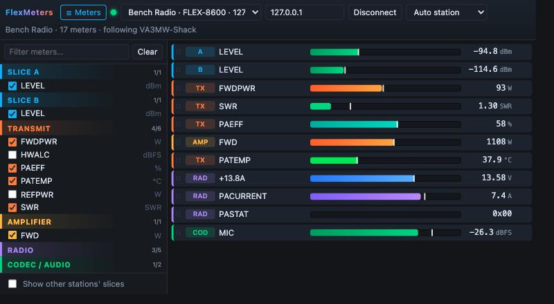

# FlexMeters

**[Project page and download →](https://va3mw.github.io/FlexMeters/)**



A compact, receive-only meter viewer for FlexRadio 6000/8000/Aurora radios. It lists every meter the radio announces, and you tick the ones you want. They show as dense, colour-coded rows: bar, peak hold and value.

## Use

1. Run `FlexMeters.exe`. Radios found on the LAN appear in the drop-down. You can also type an IP.
2. **Connect**. FlexMeters joins as a non-GUI client and binds to your SmartSDR station: automatically if there is only one, otherwise pick it from the station list.
3. Open **☰ Meters** and tick meters. Groups are Slice A/B/…, Transmit, Amplifier, Radio and Codec/audio. Hover a meter to see the radio's description.
4. Drag rows to reorder them. Click a bar to set its display range (SWR defaults to 1–3). ✕ removes a row.
5. Close the picker to leave just the meters.

Your selection, order, ranges, radio and station are saved in `%AppData%\FlexMeters\settings.json`. Each run writes `FlexMeters.log` next to it. A selected meter whose source goes away (a slice is closed, an amplifier is turned off) stays in place, greyed out, and comes back when the source returns.

Slice meters are stored by **slice letter**, so "A LEVEL" follows whatever slice A is next time. By default, other stations' slices are hidden. Tick *Show other stations' slices* to see them.

FlexMeters is **receive only**. It sends `sub client|slice|radio|meter all`, `meter list`, `info`, `client udpport`, `client bind` and `ping`, and nothing that changes how the radio operates. (`client program <name>` is not sent: v4.3.16 rejects names it does not know.)

## Build and test

```
go test ./internal/...
wails build -platform windows/amd64 -skipbindings   # -> build/bin/FlexMeters.exe
```

On this Mac, the native Wails build does not link: the Command Line Tools linker rejects the macOS 27 SDK. To try the UI without Windows:

```
go run ./tools/fakeradio -churn   # fake FLEX-8600 "Bench Radio" on 127.0.0.1; slice B closes/reopens every 20 s
go run ./tools/preview            # same app, UI served at http://127.0.0.1:34200
```

`preview` runs the real app code behind a small HTTP shim, standing in for the Wails bindings. It connects to real radios too.

## Layout

```
main.go                 Wails window; binds internal/app
internal/app            UI-facing API: state, connect, layout, 15 Hz value pump
internal/flex           discovery, TCP API client, meter status + VITA meter packets
internal/config         settings.json
frontend/dist           the whole UI (one HTML file, no build step)
docs/                   GitHub Pages site
tools/fakeradio         radio simulator for testing
tools/preview           browser preview harness
```
